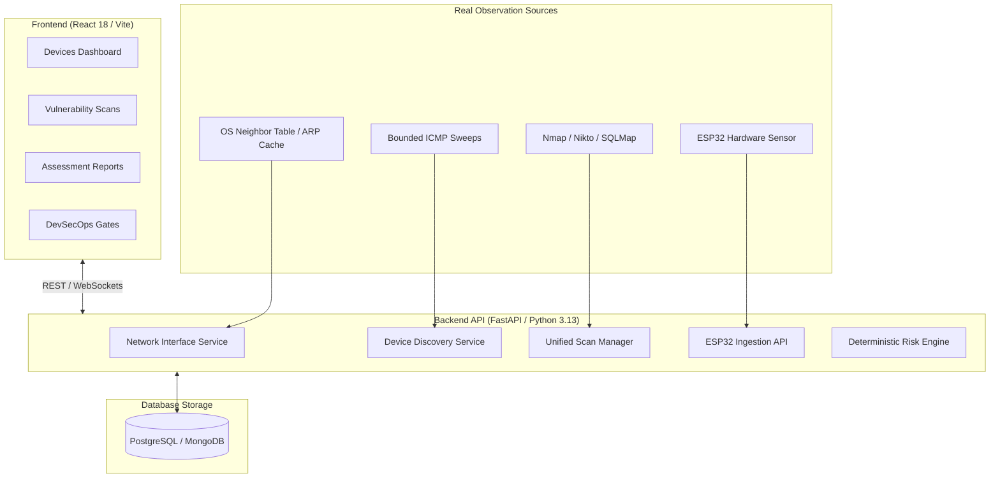

# SNID-VulnAI: Defensive Cybersecurity & DevSecOps Platform

An enterprise AI-assisted defensive cybersecurity, network discovery, and DevSecOps platform combining real-time local network inventory, ESP32 wireless security monitoring, and evidence-backed vulnerability assessment pipelines.

---

## 🚀 Key Capabilities

### 1. Genuine Network Device Discovery (SNID)
- **Zero Mock Devices:** Completely replaces hard-coded or seeded device records with genuine operating-system observations.
- **OS Neighbor-Table Ingestion:** Automatically inspects OS ARP and IPv6 neighbor caches (`arp -a`, `ip neigh`) bound to active network interfaces.
- **Network Interface & Topology Detection:** Dynamically detects active physical (Ethernet, Wi-Fi) and virtual/VPN adapters, subnets, and default gateways across Windows and Linux.
- **Strict Scope Authorization:** Restricts active discovery to approved RFC 1918 subnets (`10.0.0.0/8`, `172.16.0.0/12`, `192.168.0.0/16`) with bounded concurrency (max 256 hosts).
- **IEEE OUI Manufacturer Resolution:** Maps hardware MAC addresses to legitimate hardware vendors while detecting randomized MAC addresses.
- **Evidence-Backed Classification:** Devices default to `Unassessed` or `Low` rather than false-positive `High` risk classifications.

### 2. Evidence-Based Vulnerability Assessment Pipeline
- **Integrated Toolchain:** Multi-engine scanning utilizing Nmap, Nikto, Wapiti, SQLMap, Gobuster, and Wappalyzer.
- **Evidence-Backed Normalization:** Every finding requires verified scanner output lines, status codes, and deterministic vulnerability signatures.
- **Executive & Technical Reports:** Generates structured Markdown and PDF reports with OWASP risk ratings and remediation roadmaps.

### 3. ESP32 Wireless Sensor & Rogue AP Detection
- **Defensive RF Telemetry:** Ingests live 802.11 beacon, probe, and frame anomaly events via authenticated REST sensors (`X-Sensor-Key`).
- **Deauthentication Burst Detection:** Flags 802.11 deauth attacks and evil-twin access points cloned against authorized network baselines.
- **5-Minute Telemetry Deduplication:** Suppresses alert fatigue while maintaining high-fidelity audit trails.

---

## 🏛️ System Architecture



---

## 🛠️ Project Structure

```text
SNID-VulnAI/
├── README.md                                          # Project overview and documentation
├── skills-lock.json                                   # Installed agent skills configuration
└── vulnai-devsecops-frontend (2)/
    └── vulnai-frontend/
        ├── backend/                                   # FastAPI Backend
        │   ├── app/
        │   │   ├── routers/                           # API Routes (devices, network, scans, snid)
        │   │   ├── services/                          # Discovery, Interfaces, OUI, Scanners
        │   │   ├── parsers/                           # Nmap, Nikto, SQLMap, Wapiti parsers
        │   │   ├── models/                            # Database models
        │   │   └── main.py                            # FastAPI application entrypoint
        │   └── tests/                                 # Pytest automated test suite (91 passing tests)
        ├── src/                                       # React / Vite Frontend
        │   ├── pages/                                 # Devices, Scans, Reports, Dashboard
        │   ├── components/                            # Cyberpunk UI Components, Modals
        │   └── App.jsx                                # Main React Router configuration
        ├── package.json                               # Frontend dependencies
        └── docker-compose.yml                         # Docker Compose configuration
```

---

## ⚡ Quick Start Guide

### 1. Backend Setup
```powershell
# Navigate to backend directory
cd "vulnai-devsecops-frontend (2)\vulnai-frontend\backend"

# Activate virtual environment
.\.venv_fixed\Scripts\Activate.ps1

# Start the FastAPI server
python -m uvicorn app.main:app --host 127.0.0.1 --port 8000 --reload
```
API Documentation will be available at: `http://localhost:8000/docs`

### 2. Frontend Setup
```powershell
# Navigate to frontend directory
cd "vulnai-devsecops-frontend (2)\vulnai-frontend"

# Install dependencies (if needed)
npm install

# Run the development server
npm run dev
```
Access the application at: `http://localhost:5173/devices`

### 3. Running Automated Tests
```powershell
cd "vulnai-devsecops-frontend (2)\vulnai-frontend\backend"
.\.venv_fixed\Scripts\python.exe -m pytest tests/ -v
```
All 91 unit and integration tests validate:
- Real OS interface parsing and route inspection
- ARP neighbor table extraction
- Subnet boundary enforcement (RFC 1918)
- Zero mock devices in production inventories
- ESP32 wireless event authentication and deduplication
- Deterministic scanner parsers and risk formula scoring

---

## 🔒 Security & Defensive Principles
- **No Intrusive Probes:** Scans are limited to non-intrusive ICMP echo and OS ARP tables.
- **No Default High Risk:** Newly discovered nodes default to `unassessed` until concrete evidence warrants elevation.
- **Authorized Scope Required:** Probes outside confirmed private CIDRs are rejected with `HTTP 400 Bad Request`.
- **Sensor Authentication:** Headless sensors require authenticated pre-shared keys.
