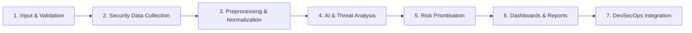
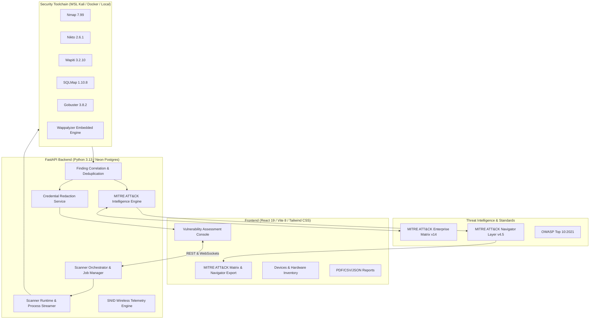

# SNID-VulnAI: Defensive Cybersecurity & DevSecOps Platform

An enterprise AI-assisted defensive cybersecurity, network discovery, and DevSecOps platform combining genuine local network inventory, ESP32 wireless security monitoring, multi-engine vulnerability assessments, and automated MITRE ATT&CK® threat intelligence mapping.

---

## ⚡ Proposed System Workflow

The platform operates across 7 end-to-end security phases:



1. **Input & Validation:**
   - Validates authorized target URLs and domains.
   - Enforces strict SSRF protection (blocking RFC 1918 private subnets `10.0.0.0/8`, `172.16.0.0/12`, `192.168.0.0/16`, loopback `127.0.0.1`, and cloud instance metadata `169.254.169.254`).
   - Restricts active network discovery to confirmed, authorized network adapters and subnets.

2. **Security Data Collection:**
   - **Nmap:** Port discovery, service banner extraction, and OS fingerprinting.
   - **Nikto:** Web server misconfiguration, dangerous HTTP methods, and outdated software detection.
   - **Wapiti:** Black-box web auditing (SQLi, XSS, SSRF, CRLF injection, file disclosure).
   - **SQLMap:** Automated SQL injection verification and database exploit evaluation.
   - **Gobuster:** High-speed URI directory and hidden path brute-forcing.
   - **Wappalyzer:** Web application software stack and CMS fingerprinting.
   - **SNID Wireless Sensor (Scapy/ESP32):** 802.11 monitor mode sniffing for deauthentication flood attacks and rogue evil-twin APs.

3. **Preprocessing & Normalization:**
   - Normalizes heterogeneous scanner logs into structured JSON finding objects.
   - Deduplicates findings across multiple tools (e.g. cross-correlating Nikto and Wapiti observations).
   - Automatically redacts sensitive query tokens, API keys, passwords, and Bearer headers from execution logs and standard outputs.

4. **AI Analysis & MITRE ATT&CK® Threat Mapping:**
   - Automatically maps vulnerabilities and intrusion alerts to **MITRE ATT&CK Enterprise Tactics & Techniques**:
     - *SQL Injection* $\rightarrow$ **T1190** (*Exploit Public-Facing Application*)
     - *Cross-Site Scripting* $\rightarrow$ **T1059.007** (*JavaScript Execution*)
     - *Exposed Ports / Services* $\rightarrow$ **T1046** (*Network Service Discovery*)
     - *Directory Enumeration* $\rightarrow$ **T1595.003** (*Wordlist Scanning*)
     - *Wi-Fi Deauthentication* $\rightarrow$ **T1498** (*Network Denial of Service*)
     - *Rogue Access Points* $\rightarrow$ **T1557** (*Adversary-in-the-Middle*)
     - *Missing Browser Headers* $\rightarrow$ **T1562.001** (*Impair Defenses*)
   - Correlates findings with known **Adversary Threat Groups** (APT28, Lazarus Group, FIN7, Volt Typhoon, Sandworm) and official **MITRE Mitigations** (`M10xx`).

5. **Risk Prioritisation:**
   - Classifies findings into tri-level semantic categories:
     - **Confirmed:** Active, corroborated exploit proof.
     - **Potential:** Heuristic warning requiring verification.
     - **Informational:** Reconnaissance data and asset telemetry.
   - Evaluates CVSS v3.1 base metrics, OWASP Top 10 coverage, and deterministic 0–100 risk scoring.

6. **Dashboards & Reports:**
   - **Cyberpunk UI Dashboard:** Live scanner progress bars, animated telemetry canvas, and real-time tool state machines.
   - **MITRE ATT&CK® Matrix View:** Collapsible tactics panel and one-click **"Export Navigator Layer (.json)"** download for direct visualization on [MITRE ATT&CK Navigator](https://mitre-attack.github.io/attack-navigator/).
   - **Multi-Format Export:** Executive and technical assessment reports downloadable in PDF, JSON, and CSV formats.

7. **DevSecOps Integration:**
   - Automated GitHub Actions CI pipeline running test suites, security validations, and production builds on push.
   - Configurable security deployment gates enforcing build pass/fail policies based on maximum allowable risk scores or critical findings.
   - Docker containerization support with isolated network runtime options.

---

## 🏛️ System Architecture



---

## 🛠️ Project Structure

```text
SNID-VulnAI/
├── .github/
│   └── workflows/
│       └── devsecops-ci.yml                           # GitHub Actions CI pipeline
├── README.md                                          # Project documentation
└── vulnai-devsecops-frontend (2)/
    └── vulnai-frontend/
        ├── backend/                                   # FastAPI Backend
        │   ├── app/
        │   │   ├── core/                              # Config, Security, Paths
        │   │   ├── routers/                           # Scans, Devices, Reports, Audit, SNID
        │   │   ├── services/
        │   │   │   ├── mitre_attack.py                # MITRE ATT&CK & Navigator generator
        │   │   │   ├── scanner_runtime.py             # Resilient async process streaming
        │   │   │   ├── scan_job_manager.py            # Live tool lifecycle & state machine
        │   │   │   ├── finding_correlation.py         # Cross-scanner deduplication
        │   │   │   ├── redaction.py                   # Secret and token scrubber
        │   │   │   └── unified_scan.py                # Multi-engine scan pipeline
        │   │   ├── scanners/                          # Wappalyzer embedded engine
        │   │   ├── parsers/                           # Nmap, Nikto, SQLMap, Wapiti parsers
        │   │   └── main.py                            # FastAPI entrypoint
        │   └── tests/                                 # 109 automated tests (100% passing)
        │       ├── test_mitre_attack.py               # MITRE mapping & Navigator layer tests
        │       ├── test_scanner_execution_reliability.py # Subprocess & timeout tests
        │       └── test_unified_scan.py               # Orchestrator & parser tests
        ├── src/                                       # React 19 Frontend
        │   ├── components/
        │   │   ├── MitreAttackMatrix.jsx              # MITRE ATT&CK Matrix & Navigator Export
        │   │   └── CyberpunkUI.jsx                    # Cyber UI primitives
        │   ├── pages/
        │   │   ├── ScanPage.jsx                       # Vulnerability assessment console
        │   │   └── Devices.jsx                        # Real device inventory
        │   └── App.jsx
        └── package.json                               # Vite 8 & Tailwind 4 setup
```

---

## ⚡ Quick Start Guide

### 1. Backend Setup
```powershell
# Navigate to backend directory
cd "vulnai-devsecops-frontend (2)\vulnai-frontend\backend"

# Activate Python 3.13 virtual environment
.\.venv_fixed\Scripts\Activate.ps1

# Start FastAPI server
python -m uvicorn app.main:app --host 127.0.0.1 --port 8000 --reload
```
* Interactive API Documentation: `http://localhost:8000/docs`
* Preflight Scanner Diagnostics: `http://localhost:8000/api/scans/diagnostics`

### 2. Frontend Setup
```powershell
# Navigate to frontend directory
cd "vulnai-devsecops-frontend (2)\vulnai-frontend"

# Install dependencies
npm install

# Run Vite development server
npm run dev
```
* Access Web Application: `http://localhost:5173/scan`

### 3. Run Automated Tests
```powershell
cd "vulnai-devsecops-frontend (2)\vulnai-frontend\backend"
.\.venv_fixed\Scripts\python.exe -m pytest tests/ -v
```
**Test Results: 109 passed, 0 failed in 64s.**

The automated test suite verifies:
- MITRE ATT&CK technique and tactic categorization
- Standard ATT&CK Navigator layer JSON generation
- Resilient subprocess streaming and process group cleanup
- Timeout enforcement (`124` / `1` exit codes) and cancellation handling
- Secret masking in command lines, standard error, and database records
- SSRF prevention against RFC 1918 and cloud metadata IPs
- Cross-scanner finding deduplication and verification grading

---

## 🛡️ Exporting to MITRE ATT&CK Navigator

1. Run an assessment on `http://localhost:5173/scan`.
2. Scroll to the **MITRE ATT&CK® Threat Posture** card.
3. Click **"Export Navigator Layer (.json)"** to download your custom layer file.
4. Navigate to [MITRE ATT&CK Navigator](https://mitre-attack.github.io/attack-navigator/).
5. Click **Open Existing Layer** $\rightarrow$ **Upload from local** and select your downloaded JSON.
6. The interactive matrix will display your target's threat heatmap with findings, scores, and threat actor intelligence.
